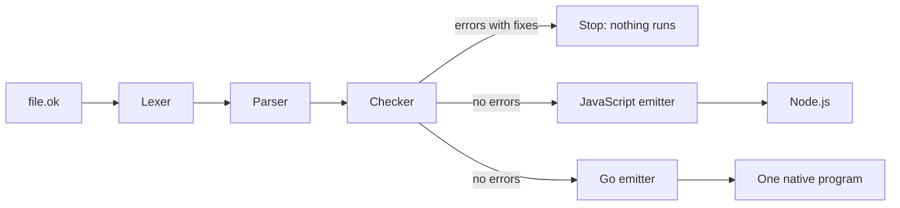

<div align="center">

# Okto

**A small, strict programming language that catches the mistake before the program runs, and tells you how to fix it.**

Keywords in English and Arabic · compiles to JavaScript and to one native program · safety rules built into the language

[](https://github.com/ahmedbebars/okto-lang/actions/workflows/ci.yml)
[](https://github.com/ahmedbebars/okto-lang/actions/workflows/codeql.yml)
[](https://scorecard.dev/viewer/?uri=github.com/ahmedbebars/okto-lang)
[](https://github.com/ahmedbebars/okto-lang/releases)
[](LICENSE)

[Website](https://ahmedbebars.github.io/okto-lang/) · [Language guide](AI-GUIDE.md) · [Design](DESIGN.md) · [Changelog](CHANGELOG.md) · [Contributing](CONTRIBUTING.md)

</div>

> [!NOTE]
> Okto is young (version 0.5). The language works and is tested on two backends, and it can
> serve a simple website, but it has no imports, no outgoing network and no database driver yet. See [what is missing](#status-and-limits)
> before you plan anything serious on it.

## Why another language?

Most bugs that reach production belong to a few families. Okto removes each family in the language itself:

| The usual problem | What Okto does |
|---|---|
| A value is `null` where nobody expected it | Only a type marked `?` can hold `none`, and it cannot be used until it is checked |
| A list changes because another name pointed at it | Lists, dicts and records are copied on assignment. Two names never share one value |
| A typo or a wrong type is found by a customer | The checker rejects the program before it runs |
| An error message that explains nothing | Every error has a code, a message and a `fix:` line you can apply directly |
| A dependency reads files it has no business reading | A program touches files and environment values only if it says so with `allow` |
| A password ends up in a log | A `secret` cannot be printed, written or put inside a text |
| SQL injection | A query is its own type. Values travel apart from the query text |

## A taste

```python
let names = ["core", "tower-1", "tower-2", "shop"]
let pings = ["12", "85", "timeout", "40"]

var slow: list[text] = []
for i in range(len(names)):
    let ms = to_int(pings[i])      # ms is "int?": it may be none
    if ms == none:
        continue
    if ms > 50:                    # here Okto knows ms is a real int
        push(slow, names[i])

print("slow: {slow}")
```

Remove the `if ms == none` check and the program does not run. Okto stops and says:

```text
error[E106] routers.ok:8:8
    8 |     if ms > 50:
      |        ^
  'ms' may be none here
  fix: check first: if ms != none:   or give a default: ms ?? value
```

### The same language in Arabic

Every keyword and built-in function has an Arabic form. Both forms can be mixed in one file,
and error messages come in Arabic with `--ar`.

```text
دالة مجموع(أرقام: قائمة[عدد]) -> عدد:
    متغير الناتج = 0
    لكل رقم في أرقام:
        الناتج = الناتج + رقم
    ارجع الناتج

اطبع("المجموع: {مجموع([90، 75، 60])}")
```

### Safety is part of the language

```python
allow read "data"                 # without this line the program is rejected
allow env "API_KEY"

let key = secret_env("API_KEY")   # a secret: it cannot be printed or logged
if key != none:
    print(secret_equals(key, "guess"))        # compared in constant time

let name = "x' or 1=1 --"
let q = sql("select * from users where name = {name}")
print(sql_text(q))                # select * from users where name = ?
print(sql_values(q))              # [x' or 1=1 --]   (the value never joins the query)
```

### A small website

```python
allow serve "127.0.0.1:8080"     # the one address this program may use

fn handle(req: Request) -> Response:
    let name = req.query["name"] ?? "world"
    let page = html("<h1>Hello, {name}!</h1>")      # the value is escaped: no injected tags
    return Response(status: 200, type: "text/html; charset=utf-8", body: to_text(page))

serve("127.0.0.1:8080", handle)
```

`okto run examples/web.ok`, then open http://127.0.0.1:8080. `okto build` turns the same file
into one native server program.

## Quick start

You need **Python 3.10 or newer**. To run programs you also need **Node.js 22 or newer**.
To build a native program you need **Go 1.26 or newer** (optional).

Install the `okto` command:

```bash
pip install git+https://github.com/ahmedbebars/okto-lang
```

Or download the single file `okto.pyz` from the [latest release](https://github.com/ahmedbebars/okto-lang/releases/latest)
and run it with `python okto.pyz` in place of `okto`.

Write a first program in `hello.ok`:

```python
fn greet(name: text) -> text:
    return "Hello, {name}!"

print(greet("world"))
```

Run it:

```bash
okto run hello.ok
```

Turn it into one native program that runs on a machine with nothing installed:

```bash
okto build hello.ok
```

### Commands

| Command | What it does |
|---|---|
| `okto run file.ok [values]` | Check, then run on Node. The values reach the program through `args()` |
| `okto run --go file.ok` | Check, then run through Go (slower start, faster program) |
| `okto check file.ok` | Check only |
| `okto build file.ok [-o out]` | Check, then make one native program (needs Go) |
| `okto build --js file.ok` | Check, then write a JavaScript file |
| `--ar` | Messages in Arabic |
| `--json` | Errors as JSON, for editors, tools and AI assistants |

## Made for AI assistants too

An assistant writes better code in a language it can hold in its head. Okto is built for that:

- **The whole language fits in one file.** [AI-GUIDE.md](AI-GUIDE.md) is the complete reference,
  and its examples are run by the test suite, so it cannot drift from the compiler.
- **One way to do each thing.** No methods, no operator tricks, no truthiness, no shadowing.
- **Errors a machine can act on.** `okto check file.ok --json` returns each error with its
  position and a fix:

```json
{
  "ok": false,
  "file": "examples/mistakes.ok",
  "errors": [
    {
      "code": "E103",
      "line": 5,
      "col": 1,
      "message": "'limit' cannot be changed",
      "fix": "define it with 'var limit = ...' if it must change"
    }
  ]
}
```

Working on this repository with an AI coding agent? Point it at [AGENTS.md](AGENTS.md).

## How it works



The compiler is about 3,400 lines of Python with **no dependencies**. Both backends must print
exactly the same output: every test program runs on Node and on Go, and the results are compared.

### Speed

Counting the prime numbers below 3,000,000 with the same simple loop
([examples/speed.ok](examples/speed.ok)), on one Windows laptop:

| | Time |
|---|---|
| Okto, Go backend | 1.35 s |
| Okto, Node backend | 1.65 s |
| The same loop in CPython 3.12 | 46.8 s |

This is one small measurement of plain integer loops, not a general benchmark.

## Status and limits

What works today (version 0.5): the full checker, records, lists, dicts, text functions, files,
permissions, secrets, safe queries, a simple web server with safe html, both backends,
English and Arabic keywords and messages.

What is not built yet:

- Imports and libraries, outgoing network requests, a database driver, concurrency, error values.
- The web server has no HTTPS, cookies or file serving yet: put Caddy or nginx in front of a public site.
- Run-time error messages are in English only.
- Whole-number results above 2^53 differ between the Node and Go backends.
- The compiler itself needs Python.

The full list, and the reasons behind each design decision, are in [DESIGN.md](DESIGN.md).

## Documentation

| File | What is in it |
|---|---|
| [AI-GUIDE.md](AI-GUIDE.md) | The complete language reference in one file |
| [DESIGN.md](DESIGN.md) | Goals, decisions, roadmap and known limits |
| [examples/](examples/) | Programs you can run |
| [CHANGELOG.md](CHANGELOG.md) | What changed in each version |
| [CONTRIBUTING.md](CONTRIBUTING.md) | How to build, test and send a change |
| [SECURITY.md](SECURITY.md) | How to report a vulnerability |

## Contributing

Bug reports, language ideas and pull requests are welcome. Start with
[CONTRIBUTING.md](CONTRIBUTING.md). The short version:

```bash
python tests/run_tests.py
```

```bash
python tests/test_cli.py
```

## License

[MIT](LICENSE)
